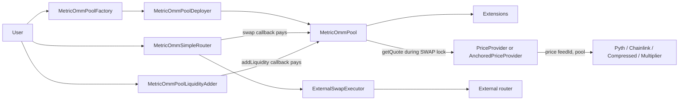

# README.md — Metric security Audit context

This file is the working context for AI agents doing security audit on the Solidity in `contracts/`. It records how the system is built, how value moves, which entry points can change state, and the rules of the [Metric Immunefi program](https://immunefi.com/bug-bounty/metric/). It is an analysis map. It is not an audit and it lists no findings.

Program snapshot used here: Immunefi public bounty record for slug `metric`, fetched 2026-11-13 (program last updated 2026-11-10). Re-read the live program before submitting. If this file and the live program disagree, the live program wins.

## How to use this file

- Do Security Audit the in-scope impacts below. A bug is reportable when it causes one of those impacts on an in-scope asset, under the primacy and feasibility rules.
- Start from the entry-point section. State-changing external and public functions are the attack surface. `view` and `pure` functions are omitted there on purpose.
- Confirm the deployed bytecode matches the file you are reading before claiming an issue. This tree has no deployment addresses and no history.
- Read [Metric known issues](https://github.com/Metricxyz/Known_issues) and the linked Zellic and Sherlock material before writing a report. A report that shares a root cause with those is out of scope.
- Build every proof on a local fork of mainnet or of a public testnet. Do not send transactions to mainnet or to a public testnet. Do not fuzz or load-test project websites, APIs, or oracles in production. The program requires a runnable proof of concept at every severity.
- Publication is Immunefi category 3: approval required. Do not publish an unpatched issue.
- KYC is not required. Rewards are USDC on Ethereum. Primacy of impact applies to every severity in the reward table.

## System in one paragraph

Metric is an oracle-priced AMM. A `MetricOmmPool` does not discover price from its own reserves. On each swap it asks its price provider for a bid, an ask, and a reference price, all in Q64.64, then walks a fixed ladder of bins whose edges are percentage distances from that reference. LPs own internal shares per `(owner, salt, bin)`, not an ERC-20. Optional extensions may reject a swap, deposit, or withdrawal after the quote is fixed; they do not replace the quote or the amounts. Routers pay the pool in a callback. Oracles store signed Pyth Lazer updates, signed Chainlink Data Streams reports, or pusher-written compressed slots. `AnchoredPriceProvider` clamps a quote so it cannot be tighter than an anchor band. `PriceProvider` shapes one feed with a confidence multiplier and a fixed margin step.

Chains named by the program: Ethereum and BSC. Languages: Solidity (`pragma ^0.8.35` in the pool and periphery, `^0.8.28` in the oracle tree).

## In-scope assets

| Asset | What this tree contains |
| --- | --- |
| [pool-contracts](https://github.com/Metricxyz/pool-contracts) | `contracts/pool/` |
| [periphery-contracts](https://github.com/Metricxyz/periphery-contracts) | `contracts/periphery/` |
| [oracle-contracts](https://github.com/Metricxyz/oracle-contracts) | `contracts/oracle/` |
| Primacy of Impact (`https://www.metric.xyz`) | Select this placeholder in the Immunefi form when the impact is in scope and the affected code is not one of the three repositories. Other Metric programs are not covered by this primacy. Test files, mocks, and testnet deployments are not covered by primacy. |

The program overview names the pool, factory, oracles, extensions, and routers as the main concerns: loss or freezing of user or LP funds, swaps at the wrong price, abuse of oracle or extension logic, and ways around access control and timelocks.

Code that is not in this tree:

- Every `interfaces/` import (`./interfaces/...`, `@metric-core/interfaces/...`). Behavior below is taken from the implementations that are present.
- OpenZeppelin, `pyth-lazer-sdk`, and any other dependency. A bug in those libraries is out of scope unless this code uses them incorrectly.
- The propAMM adapter. The high impact "unauthorized use of protocol roles: factory owner, oracle `ADMIN_ROLE`, propAMM adapter admin" names that role, and the September 2026 Sherlock review covered a separate propAMM adapter. There is no propAMM source under `contracts/`.
- Off-chain pushers, quote and maker services, `pamm-quote`, keepers, the API, the SDK, the app, and the docs.

## Impacts in scope

Only these impacts are accepted. Severity is the program's label.

### Critical

- An oracle accepts a price update without a valid Pyth or Chainlink signature, or a compressed-feed push from an unauthorized pusher.
- Direct theft of any user funds, whether at rest or in motion, other than unclaimed yield.
- Protocol insolvency.

Critical requires at least $10,000 of funds directly at risk. Below that, the report is assessed as High at most. Critical smart-contract reward is 20% of funds directly affected, minimum $50,000, maximum $500,000, measured at report time. Permanent freezing of funds is also Critical in the impact list, and that critical is capped at $200,000.

### High

- Bypassing the admin fee caps or the price-provider timelock.
- Swap on a Metric anchored price provider pool executes outside the band or beyond its configured staleness limit.
- Unauthorized use of protocol roles: factory owner, oracle `ADMIN_ROLE`, propAMM adapter admin.
- Permanent freezing of funds (cap above).
- Temporary freezing of funds.
- Theft of unclaimed yield.
- Theft of unclaimed royalties.
- Permanent freezing of unclaimed yield.
- Permanent freezing of unclaimed royalties.

High and Medium rewards are 20% of funds directly affected, floored and capped by the tier. High is $10,000–$50,000. For temporary freezing, the counted value doubles for every extra 24 hours the funds stay frozen, up to the high cap. Theft or permanent freezing of unclaimed yield or royalties is rewarded on 100% of the funds at risk, still inside the high range. There is no royalty token in this tree; do not invent a royalty impact to fit a fee bug. Unclaimed yield here means value the protocol has already accounted to LPs or to fee recipients and not yet paid.

### Medium

- Bypassing the deposit or swap allowlist extensions.
- Successful swap on a paused pool.
- Fees reach the wrong destination: protocol or admin fees go somewhere other than the configured receiver.
- A configured stop-loss check is bypassed.
- Block stuffing.
- Griefing (damage to users or the protocol with no attacker profit).
- Theft of gas.
- Unbounded gas consumption.

Medium is $2,500–$10,000. Rounding or precision loss under 0.01% and $10 is out of scope unless it can be repeated until it reaches Medium or higher.

### Low

- Malicious price-provider implementation that can cause significant LP losses. The rewards text says the team may pay these at its discretion. Third-party providers, sources, and extensions are separately out of scope. A break of `AnchoredPriceProvider`'s band or staleness invariant is the High impact above, not this Low item.
- Contract fails to deliver promised returns, but doesn't lose value.

Low is a flat $1,000.

### Reward mechanics that change severity

- If the vulnerable contract can be upgraded or paused, only the first attack counts. Later attacks, each 24 hours after the first, count 50% of the previous amount, rounded down.
- An attack that needs a user to interact with a pool, extension, or price provider the attacker created is downgraded one severity level.
- Standard Immunefi feasibility limits apply, including attack investment amount: when the capital required exceeds the potential gain, severity may be downgraded. Chain rollbacks, pre-impact monitoring, attacks that put the attacker at financial risk, and griefing downgrades follow the Immunefi articles linked from the program.
- Pools the user created with unreasonable or malicious parameters are out of scope. Pool risk tiers are informational. Users are expected to inspect the pool they deposit into.

## Out of scope

### Trusted roles and configuration

Out of scope when the issue needs a malicious, compromised, or careless:

- Factory owner.
- Oracle `ADMIN_ROLE` (blacklist, integrators, approved factories, registration fee, `withdrawEth`).
- PriceProvider factory admin or AnchoredProvider factory admin.

Pool admin, acting inside the bounds the code allows, is out of scope: admin fees up to the cap, a price-provider change that waits out its real timelock, pausing their own pool, and bin and extension settings. Bypassing those caps, or bypassing an honestly configured timelock, is in scope at Medium or above.

The factory owner may set `bidAskRefAsymmetryX8` on an existing pool with no creation-cap check, including `type(uint16).max`, which disables the bid/ask/reference asymmetry check. That is owner authority. `setPoolDeployer` can be called once. `setFeeCaps` cannot exceed the hard constants. `Authority.canCall` is an optional delegate the owner can attach; a report that the owner can delegate is centralization.

### Oracles and off-chain systems

- Wrong, manipulated, or stale data from Chainlink, Pyth, a compressed pusher, or a signer. The program assumes that data is correct and fresh. What is in scope is this code accepting an update that those signers did not authorize, or consuming a fresh authorized price in a way that breaks a pool invariant.
- A pool halting because a feed is stale or down (`FeedStalled`, staleness checks, Chainlink deviation or sequencer checks). That halt is intended. Swaps stop. Deposits and withdrawals stay available, subject to extensions.
- Off-chain infrastructure listed in the assets section.

The default Immunefi oracle exclusion does not exclude oracle manipulation or flash-loan attacks. A flash loan that moves a third-party venue, which an `AnchoredPriceProvider` source then widens toward, is the documented source-widening behavior below. A flash loan that breaks the band clamp or the signature check is in scope.

### Tokens, foreign code, and external routers

- Non-standard ERC-20s: fee-on-transfer, rebasing, transfer hooks (ERC-777), fewer than 6 or more than 18 decimals, revert on a zero-amount transfer. USDC and USDT are in scope. The effect of their issuers blocklisting an address is not.
- Price providers, sources, and extensions written and deployed by third parties, and any issue that depends on them. The in-tree providers and the four shipped extensions are Metric code.
- External protocols and routers reached through `externalSwap` / `ExternalSwapExecutor`. Losses caused by those routers or by integrators, including a gas limit that is too small, are out of scope. A bug in Metric's own executor or router that loses funds with a well-behaved external target is still direct theft.

### Market and execution risk

- Front-running, sandwiching, and other MEV inside the user's slippage or deadline. Gas griefing, block stuffing as an L1/L2 congestion tactic, reorgs, and sequencer or builder behavior. The impact list still contains a Medium "block stuffing" and "theft of gas" entry; use those only when the program's own text accepts them, and expect the custom market-risk exclusion to govern ordinary MEV.
- LP losses from market risk: adverse selection, a wide spread, an unfavourable provider configuration, impermanent loss.
- The dust threshold in the Medium section.

### Already known, not deployed, or general

- Issues in the known-issue documents or audit reports, and any report with the same root cause. Audits linked by the program: Zellic (2026-06-28) and Sherlock (2026-10-09), plus the docs at [Security and audits](https://docs.metric.xyz/reference/security-and-audits). Docs say later changes, after the last audited commits, are: a precision fix in the bid/ask/reference asymmetry check and a higher optimizer in the pool; the quoter reverting `PoolPaused` for paused pools; a change to how `PriceProvider` and `AnchoredPriceProvider` set the minimum ask; and the multiplier oracle for tokenized stocks, which those audits did not cover. Comments, docs, and formatting are the rest. Verify against the known-issue repo rather than assuming a post-audit diff is new and vulnerable.
- Contracts that are not in-scope assets, superseded deployments, tests, mocks, scripts, deploy tooling, testnets, and code that is not deployed or that is already fixed in the deployed version.
- Gas micro-opts, style, missing events, informational notes, best-practice notes, feature requests, and centralization of trusted roles.
- Stolen keys, phishing, social engineering, physical access, leaked GitHub secrets with no proof they are used in production, website or API denial of service, and rate-limit issues.
- Bugs in the chain, the EVM, the compiler, or standard libraries, unless this code uses them incorrectly.
- 51% attacks, lack of liquidity, Sybil attacks, and an external stablecoin depeg the attacker did not cause through a bug in this code.
- Attacker-caused damage the reporter has already exploited.

## Architecture

### Pool

`MetricOmmPool` is not a constant-product pool. Immutables (set only in the constructor, checked by the factory before deploy) include the factory, both tokens, scale multipliers, empty-bin share density, `minimalOperationalLiquidity`, bin bounds, up to seven extension addresses, per-action call order, and either an immutable price provider or a slot for a mutable one.

Mutable slot 0 packs pause level, current bin index, position inside that bin (`0` at the lower edge, `type(uint104).max` at the upper edge), the lower edge's distance from the reference in E6, the platform spread fee, the platform notional fee, and `bidAskRefAsymmetryX8`. Slot 1 is the sum of scaled token balances across bins. Slot 2 is notional fees not yet swept. Slot 3 is the mutable provider address. `PoolStateLibrary` decodes these layouts through `EXTSLOAD`. Reordering storage or repacking a slot breaks every off-chain and on-chain reader of that layout.

Bins are a fixed ladder. Index `0` and up come from `nonNegativeBinDataArray`. Index `-1` and down come from `negativeBinDataArray`. Each bin stores scaled token balances (`uint104`), a width `lengthE6` (`1e6` = 100% of the reference), and per-direction add-fees (`uint16`, so at most `65535` / `1e6`). The current bin's lower edge is `curBinDistFromProvidedPriceE6`. Price at a point inside the bin is the linear interpolation between the two edges, each edge equal to `reference * (1e6 + distanceE6) / 1e6`. Selling token0 walks down the ladder. Buying token0 walks up. A bin with no balance on the output side is skipped. Exact-output is capped by total available output across bins. Exact-input stops when output liquidity is exhausted or the price limit binds. `priceLimitX64 == 0` means no limit on exact-input `zeroForOne`.

Internal accounting uses `max(18, token0.decimals(), token1.decimals())`. Each token has a scale multiplier of `10^(internalDecimals - token.decimals())`. Swap inputs are scaled up at the start. External deltas use `ceilDiv` for signed amounts, so the pool pulls enough raw tokens to cover the scaled requirement. The factory does not cap the decimal gap. Tokens outside 6–18 decimals are out of scope, which is also where a very large multiplier would sit.

Shares are an internal mapping `_positionBinShares[keccak(owner, salt, bin)]`. There is no transfer function. `removeLiquidity` requires `msg.sender == owner` and then transfers both tokens to `owner`. `addLiquidity` credits `owner` and pulls tokens from `msg.sender` through `metricOmmModifyLiquidityCallback`. Anyone can donate a position to any `owner`. Empty-bin minting uses `initialScaledAmount*PerE18Shares`. The current bin is pro-rated by `curPosInBin`. Adds and removes must move at least `minimalOperationalLiquidity` shares and must not leave a smaller non-zero remainder.

Pause is a `uint8`: `0` active, `1` pool-admin pause, `2` protocol pause. `swap` reverts unless the level is `0`. `addLiquidity`, `removeLiquidity`, and `simulateSwapAndRevert` do not read the pause flag. Protocol pause is allowed from `0` or `1` and sets `2`. Protocol unpause is allowed only from `2` and sets `1`, so the pool admin must unpause again before swaps resume. Admin pause is only `0 → 1` and `1 → 0`.

### Quote, fees, and the swap call

`swap` is `whenNotPaused` and takes the transient reentrancy lock with action id `PoolActions.SWAP`. While that id is set, `inSwap()` returns the resolved price provider. The provider address is the immutable one when it is non-zero, otherwise slot 3.

Order inside `swap`:

1. `getQuote()` on the provider. A revert or a quote that fails validation becomes `PriceProviderFailed` or a validation error. The pool then reverts.
2. Validation: `0 < bid < ask`, and `bid <= reference <= ask`. Unless `bidAskRefAsymmetryX8 == type(uint16).max`, the reference may not sit on either edge, and the two relative gaps around the reference must lie within `M = 1 + m` of each other (`m` is the X8 value). This is the check the docs describe as fixed for a precision bug after the last pool audit.
3. `beforeSwap` extensions, in the packed 3-bit order. They see the quote and the initial slot 0. They cannot write the quote the swap will use.
4. Base fee for the direction: sell-base from `(reference - bid) / reference`, buy-base from `(ask - reference) / ask`, converted to Q64.64. The active bin adds its add-fee and the pool's notional fee. The trader executes at the fee-adjusted edge prices.
5. The platform's share of that fee is withheld from the input and does not enter the bins. The spread portion of the platform fee stays in the pool as surplus balance. The notional portion is added to `notionalFeeToken*Scaled`. The rest of the input enters the bin and is LP inventory. `spreadFeeE6` and `notionalFeeE8` on the pool are the sums of the protocol and admin legs stored on the factory.
6. Output tokens are sent to `recipient` before the callback. `metricOmmSwapCallback` must bring the input balance up by the positive delta. The check is `balanceBefore + delta > balanceAfter` reverting, so the pool requires the balance to increase by at least the delta.
7. `afterSwap` extensions see both slot 0 snapshots, both deltas, and the platform fee amount.
8. The lock clears when `swap` returns. The callback runs before that, so `inSwap()` is still the provider during payment. Guarded pool functions revert if reentered. `setPause` and `setPriceProvider` are ungarded and `onlyFactory`.

`simulateSwapAndRevert` takes a different action id, so `inSwap()` stays `address(0)`. The caller supplies bid, ask, and reference. The function always reverts `SimulateSwap`. A catching caller rolls the pool's writes back with the call. Extensions still run, and a state write they make is rolled back with that call. The live quoter refuses paused pools before calling it. The pool function itself does not.

`getSellAndBuyPrices` also takes the `SWAP` action id, so a direct call lets the provider pass the oracle `inSwap` check for the length of `getQuote`. It returns the fee-adjusted marginal buy and sell prices at the current bin position. It does not move the bin.

`collectFees` is `onlyFactory`. It treats any raw balance above bin totals, notional fees, and already-pending admin and protocol fees as spread surplus, splits that surplus by the factory's protocol and admin spread legs, splits the notional bucket by the notional legs, then pays both destinations with `trySafeTransfer`. A failed transfer emits `FeeTransferFailed` and leaves the pending amount in place. Anyone may call `factory.collectPoolFees(pool)` to push those amounts to the configured receivers.

Hard fee ceilings on the factory, in the units the setters use:

| Cap | Constant | Meaning |
| --- | --- | --- |
| Protocol spread | `500_000` | 50% in E6 |
| Admin spread | `500_000` | 50% in E6 |
| Protocol notional | `1_000_000` | 1% in E8 |
| Admin notional | `1_000_000` | 1% in E8 |

Creation clamps a requested protocol fee up to the current default when the request is lower, then adds the admin leg. The sum is what the pool stores. Later `setPoolAdminFees` collects first, checks the admin legs against the live caps, and writes the new sum. `setPoolProtocolFee` can also lower an admin leg that now exceeds a reduced cap. Per-bin add-fees are not passed through those caps; they are pool-admin bin settings (`uint16`).

Price-provider rotation lives on the factory. `priceProviderTimelock == type(uint256).max` deploys the provider as an immutable. The pool then ignores slot 3. Any other timelock, including `0`, stores a mutable provider. The admin proposes, `executeAfter = block.timestamp + timelock`, and execute requires `block.timestamp >= executeAfter` plus a fresh `token0`/`token1` match. A timelock of `0` can therefore be proposed and executed in the same block. That is the documented "replaceable at once" setting. Bypassing a non-zero timelock that was actually configured is the High impact.

`createPool` is permissionless once `poolDeployer` is set. The deployer is `CREATE2`. The salt commits admin, admin fee destination, extension init bytes, timelock, and each fee leg after the protocol-floor clamp. Extension addresses and order are fixed for the life of the pool. `initialize` on each extension runs before the factory writes `poolAdmin` and the registry index, so an extension cannot read those inside `initialize`. Up to seven distinct non-zero extensions. Orders are 3-bit indices, least significant group first, terminated by a zero group.

### Extensions shipped in this tree

| Extension | Hook that is live | Who can change settings |
| --- | --- | --- |
| `SwapAllowlistExtension` | `beforeSwap` is `view`. Allows the pool's `msg.sender` (the router, for a routed swap) or, for `simulateSwapAndRevert`, the `sender` argument. | Pool admin, immediate |
| `DepositAllowlistExtension` | `beforeAddLiquidity` is `view`. Allows the position `owner`, not the payer. | Pool admin, immediate |
| `PriceVelocityGuardExtension` | `beforeSwap` writes per-`msg.sender` anchors. The first observation only seeds. Later observations bound the reference move by `maxChangePerBlockE18 * sqrt(1 + blockDiff)` from the anchor, compared in squares. The pool admin is described in the contract as trusted. | Pool admin, immediate |
| `OracleValueStopLossExtension` | `afterSwap` requires `oracleStopLossConfig[msg.sender].initialized`. Initialization is factory-only at pool creation. `drawdownE6 == 0` stores a config that does not enforce a drawdown. Later parameter changes wait out the pool's own timelock. | Pool admin, timelocked after init |

Unimplemented hooks on the base revert `ExtensionNotImplemented` and are `onlyPool`. The shipped overrides of `beforeSwap`, `beforeAddLiquidity`, and `afterSwap` do not use `onlyPool`. Allowlist hooks are `view` and key storage by `msg.sender`. The velocity hook and the stop-loss hook write storage. A caller who is not a pool can write only the velocity slot of their own address, or, for stop-loss, can pass only when that address was initialized by the factory.

`extensionData` is caller-supplied and forwarded unchanged to every extension of that action.

### Periphery

`MetricOmmSimpleRouter` swaps exact-input and exact-output, single hop or path. It will only set a callback context for a pool `factory.isPool` accepts. The callback checks that transient expected pool and checks `isPool` again. Exact-input pays `msg.sender` on the first hop and the router on later hops. Exact-output walks the path backwards inside the callback. Path length is capped by `MAX_PATH_POOLS` (256). Deadlines and slippage are the user's.

`multicall` and `sequence` on the router do not take the reentrancy lock; each delegated step does. `sequence` can continue or stop on success or failure per step. `multicall` reverts the whole batch if one step reverts.

`unwrapWETH9`, `sweepToken`, and `refundETH` send the router's entire balance of WETH, of the token, or of ETH to a caller-chosen recipient. `receive` accepts ETH only from WETH. These are the usual router leftovers functions. A report that anyone can sweep tokens the user left on the router is that design.

`externalSwap` pulls `amountInMaximum` to an `ExternalSwapExecutor` bound to this router, force-approves the user-supplied external router, calls it, refunds unused input, and checks the recipient's output balance. The executor refunds residual input and output to the router and the recipient. Losses that come from the external target are out of scope.

`MetricOmmPoolLiquidityAdder` is the deposit helper. Exact-share methods pull up to the caller's caps. Weighted methods probe with `addLiquidity` and a callback that reverts `LiquidityProbe`, then scale shares and pay. The pay callback requires the transient expected pool. The adder's `multicall` does not check the lock before `delegatecall`; the add functions take `nonReentrant` themselves.

`MetricOmmSwapQuoter` and `MetricOmmPoolDataProvider` are lenses. Live quotes call `getQuote` on the provider and then `simulateSwapAndRevert`, and they revert `PoolPaused` when slot 0 says the pool is paused. Hypothetical quotes use caller-supplied prices and do not apply that pause check. `getQuote` from the quoter does not hold the pool's `SWAP` lock. On-chain, Pyth, Chainlink, and Multiplier `price` therefore reject that read unless `tx.origin == address(0)`. That zero-origin path is what the oracle comments describe for off-chain `eth_call`. A state-changing transaction from an EOA does not have `tx.origin == address(0)`.

### Oracles and providers

Four oracle families:

| Family | How a price is written | How a price is read |
| --- | --- | --- |
| `PythOracle` | Permissionless `fallback`. Calldata is a feed-id list plus a Lazer payload. `PythLazer.verifyUpdate` is the trust anchor (`PYTH_VERIFICATION_FEE` is 1 wei, paid from the contract balance). Any feed id inside a verified payload is stored. Monotonic per-feed timestamp. | `OracleBase.price` |
| `ChainlinkOracle` | Permissionless `updateReport` / `updateReports`. First byte is a version tag. The rest goes to the `VerifierProxy` the admin registered for that tag, via `verifyView` or payable `verify` with a fee constant of 0. | `OracleBase.price` |
| `CompressedOracle` | Permissionless `fallback`: the sender writes its own namespace, or `namespaceRemapping[msg.sender]` if a creator delegated it. `updateBySignature` writes a creator's slot when the creator's EIP-191 signature matches. `allowPushers` requires the pusher's signature over `(chainid, oracle, deadline, pusher, creator)` and a strictly newer deadline. `allowContractPushers` staticcalls `isPusher(creator)` on the pusher contract. One remapping slot per pusher, last writer wins. | `price` is permissionless and only emits `PriceRead`. The `pool` argument is not checked. `getOracleData` stays `view`. `Extsload` can read the same slots. |
| `MultiplierOracle` | No price storage. `createFeed` is permissionless. A stock feed binds an underlying feed, a token, and an allow-listed params adapter. A passthrough feed is token and params both zero. | `price` applies the same in-swap, blacklist, and registration checks as the underlying, then `integratorPrice` on that underlying, then scales by the adapter's multiplier. Disabled feeds, a failed adapter, a zero multiplier, a paused issuer, or a bad underlying read return the stall sentinel. |

`OracleBase.price` (Pyth and Chainlink) reverts unless the caller is not blacklisted and, when `tx.origin != address(0)`, `pool.inSwap() == msg.sender`, the pool is not blacklisted, and `registeredPool[feedId][pool]` is set. Providers pass the pool through as `pool` and themselves as `msg.sender`. Registration is permissionless: pay `registrationFee`, pass an approved factory, and `factory.isPool(pool)`. Paying clears a blacklist on that pool. Overpayment is kept for `ADMIN_ROLE.withdrawEth`. `integratorPrice` is a separate allowlist and does not use `inSwap`.

`PriceProvider` reads one feed. It halts (`bid = 0`, `ask = type(uint128).max`, and `getQuote` then reverts `FeedStalled`) when the feed is stale against its immutable `MAX_TIME_DELTA` (1 second through 7 days), the spread is the stall sentinel or wider than 5%, the mid breaks the oracle price guard, or shaping cannot keep `0 < bid <= reference <= ask` with `bid < ask` after the covers. The reference is the oracle mid converted to Q64.64. Confidence and `marginStep` widen or bias the band around that mid. The ask is rebuilt from `(mid + 1)` so an 8-decimal Pyth or Chainlink quantum is covered. The contract comments state that a compressed U64x32 mid, and a multiplier-scaled mid, can be coarser than one quantum.

`AnchoredPriceProvider` is the provider the docs call the standard one for public pools. Every read builds a reference band from the anchor:

- Single feed: bid edge from `mid * (1 - half)`, ask edge from `(mid + 1) * (1 + half)`, with `half` the multiplied spread plus immutable `minMargin`.
- Synthetic (`quoteFeedId != 0`): cross of two legs, opposing interval edges, then an additive `minMargin` per side. Nothing on-chain checks that the two legs share a quote currency. The comments assign that choice to the deployer and the LP.
- Reference returned to the pool is the anchor mid. Source, confidence, `marginStep`, and spread multipliers do not change it.
- Source mode (`source != 0`): the source is `staticcall`ed with a 500,000 gas cap and must return 96 bytes `(bid, ask, reference)` with the source's own reference inside its quote. The clamp then does `bidOut = min(refBid, sourceBid)` and `askOut = max(refAsk, sourceAsk)`. An edge tighter than the band is pushed out to the band. An edge wider than the band is kept. The comments state that widening is unbounded, that a source is trusted for that direction, and that an instant `setSource` can widen or halt and cannot move the reference the pool uses as the fee base.
- Stale leg, saturated spread (`>= 65534`), zero mid, guard breach, or a band whose upper relative width plus `minMargin` reaches 100% halts.
- Immutable variant (`MUTABLE_PARAMS == false`): only the source pointer can change, and only through the factory, immediately, owner-only.
- Mutable variant: owner or updater can also set confidence, per-leg staleness (each `<= MAX_REF_STALENESS`), and per-leg spread multipliers (each `<= maxSpreadMult`, and multipliers may be below 1×, down to 0). Each knob has a 60-second cooldown. Sub-1× multipliers narrow the band toward `minMargin` alone. `minMargin` must be non-zero at construction.

`PriceProviderFactory.createPriceProvider` is permissionless and does not allow-list the oracle. `isProvider` means "this factory deployed it", not "its oracle is honest". `AnchoredProviderFactory.createAnchoredProvider` requires an admin-allow-listed oracle and checks `minMargin`, `maxRefStaleness`, and `maxSpreadMult` against the envelope of `baseFeedId`'s class (or `DEFAULT_CLASS`). The envelope does not bound `marginStep`, the token pair, the quote feed, or the initial per-leg multipliers' lower bound. Removing an oracle or an envelope does not change providers already deployed.

Params adapters `B20AssetParams` and `RobinhoodStockTokenParams` are view-only. `ScheduledMultiplier` applies a pending multiplier at once when the relative change is at most 10% (`SMALL_CHANGE_BPS = 1000`), and stalls a larger pending change until `effectiveAt`. The issuer is trusted for the multiplier and the pause flag. The multiplier contract says issuer-key compromise is outside its checks.

`ChainlinkOracle.setVerifier` is `ADMIN_ROLE` and has no timelock. The contract comment says that role must be a multisig because a verifier that echoes its input would let any caller store arbitrary prices. Replacing a verifier, or any other `ADMIN_ROLE` action, is the trusted-role exclusion. A path that stores a price without going through a genuine Pyth or Chainlink verification, or a compressed write into a namespace the caller does not control, is the Critical oracle impact.

## Value flows

### Create a pool

Anyone calls `createPool` after the owner has set the deployer. The caller chooses tokens, provider, bins, fees within caps, admin, timelock, asymmetry within the creation cap, and extensions. The factory validates, the deployer `CREATE2`s the pool, extensions `initialize`, then the factory records admin, fees, timelock, and the pool index. The new pool has empty bins. It can be registered on an oracle by anyone who pays the fee and passes an approved factory.

### Deposit

The LP calls the adder, or calls `pool.addLiquidity` and implements the callback. The pool runs `beforeAddLiquidity`, mints shares, updates bin totals, callbacks for payment, checks balances, then runs `afterAddLiquidity`. Pause does not block this. A deposit allowlist, if the pool ordered that hook, rejects an `owner` who is not allowed. The payer is the callback caller (`msg.sender` of `addLiquidity`), which is the adder or the direct caller, not necessarily `owner`.

### Swap

The user calls the router with a deadline and a minimum output or maximum input. The router checks the pool is registered, stores the payer in transient storage, and calls `pool.swap`. The pool reads the provider, runs extensions, moves bins, sends output, and callbacks the router. The router `transferFrom`s the user or pays from its own balance on later hops. The user can also call `pool.swap` directly if they implement `metricOmmSwapCallback`. A swap allowlist gates the pool's `msg.sender`, so a routed swap is gated on the router address, not on the end user. `simulateSwapAndRevert` is gated on the `sender` argument the caller chose.

### Withdraw

`owner` calls `pool.removeLiquidity`. Shares are burned pro-rata against the bin's scaled balances (`mulDiv` down). Tokens are transferred to `owner`. There is no callback. Withdrawal extensions, if configured, can revert the exit. The docs treat withdrawal hooks as a risk-tier signal because they can block LP exits. A third-party extension that blocks exits is out of scope. A shipped extension that blocks exits contrary to its own checks is in scope when the impact is freezing of funds.

### Fees

Traders pay the fee inside the execution price. LP inventory in the bins does not include the platform's cut. Anyone can call `collectPoolFees`. Protocol fees go to `feeReceiver`. Admin fees go to `poolAdminFeeDestination`. Changing the admin destination collects first. A failed token transfer leaves the fee pending. Fees arriving at an address other than those two configured receivers are the Medium "wrong destination" impact. The owner changing `feeReceiver`, and the pool admin changing their destination, are trusted-role actions.

### Oracle update

Anyone may push a Pyth payload, a tagged Chainlink report, or a compressed slot word. Pyth and Chainlink writes stick only after verification and only when the new timestamp is strictly newer and not too far in the future (`MAX_TIME_DRIFT`). Compressed fallback writes stick for the sender's namespace, or the creator who currently holds `namespaceRemapping[sender]`, under the same monotonic and drift checks. A signature update names the creator and checks that creator's signature. Providers do not write oracle storage. They halt when they dislike the stored value.

## Invariants the impacts map onto

These are the properties the impacts are about. A audit result is a break of one of them that the out-of-scope list does not set aside.

- Pyth storage changes only after `PythLazer.verifyUpdate` succeeds. Chainlink storage changes only after the tagged report's registered verifier returns the report. Compressed storage for a creator's namespace changes only for that creator, a pusher that creator delegated, or a signature that recovers to that creator.
- While a pool's resolved provider is an `AnchoredPriceProvider`, a successful `swap` uses a quote whose bid is at or below the provider's reference bid, whose ask is at or above the reference ask, whose reference is the anchor mid, and whose legs are inside that provider's configured staleness. The documented exception is a source, confidence, or positive `marginStep` that widens past the band: the clamp keeps that wider edge.
- `swap` on a pool with `pauseLevel != 0` reverts in `whenNotPaused`.
- Admin spread and notional writes on the factory stay within the live caps, and those caps stay within the hard constants. A mutable provider becomes the pool's resolved provider only from `executePoolPriceProviderUpdate` after `pendingPriceProviderExecuteAfter`.
- `collectFees` pays the factory's `feeReceiver` and `poolAdminFeeDestination` for that pool.
- Allowlist hooks revert when the gated address is not allowed and the allow-all flag is clear.
- A stop-loss that was initialized with a non-zero drawdown reverts an `afterSwap` that violates the configured drawdown against the decayed high-water marks. A zero drawdown is an attached hook that does not enforce one; that is configuration.
- Share accounting, bin totals, and token balances stay sufficient for `removeLiquidity` and for the output side of `swap`. A solvency break that lets a later LP or swapper be short is protocol insolvency or direct theft, subject to the amount rules.
- `onlyFactory`, `onlyOwner` / `requiresAuth`, `ADMIN_ROLE`, and `onlyPoolAdmin` hold for the functions listed in the entry-point tables. `requiresAuth` also allows `authority.canCall`. The owner can set that authority. Delegated calls are owner-granted.

Documented behavior that should not be re-filed as a bug on its own: feed halts; source widening; `tx.origin == address(0)` skipping the in-swap read gate; compressed `price` not authenticating `pool`; permissionless pool creation; timelock `0`; immutable provider when the timelock is `type(uint256).max`; asymmetry check disabled at `uint16.max`; protocol unpause landing on admin-pause; pause not covering deposits and withdrawals; router sweep of leftover balances; one compressed pusher slot shared by the last `allowContractPushers` caller; synthetic pairs whose legs do not share a quote currency; issuer pause and multiplier trusted by the multiplier oracle; admin-trusted velocity extension.

## Entry point analysis

Method: [Trail of Bits entry-point-analyzer](https://github.com/trailofbits/skills/tree/main/plugins/entry-point-analyzer), Solidity reference. `slither` is not installed in this environment, so this is the manual pass the skill requires when the printer cannot run. Scope is `contracts/`. Language is Solidity. Focus is state-changing functions only. `view` and `pure` are excluded. Internal and private functions are excluded. Constructors are excluded.

Counts are callable surfaces on concrete contracts. A function inherited by two deployed contracts is counted twice. OpenZeppelin `AccessControl` and `Multicall` are not in this tree; the row points at the local contract that exposes them. Abstract `BaseMetricExtension` hooks that a child overrides are counted on the child. Hooks the child does not override revert `ExtensionNotImplemented` before any write, so they are not counted.

Libraries other than `LiquidityLib` expose no public state-changing functions. `LiquidityLib.addLiquidity` and `removeLiquidity` are `public` because the pool delegatecalls them. A direct `CALL` to the library runs against the library's storage. The library is not the pool and is not where users' tokens sit. Both functions are still entry points.

### Summary

| Category | Count |
| --- | --- |
| Public (Unrestricted) | 74 |
| Role-Restricted | 108 |
| Restricted (Review Required) | 6 |
| Contract-Only | 21 |
| **Total** | **209** |

### Public entry points (unrestricted)

Anyone may call these. Pause flags, deadlines, signature checks, and "the argument must equal `msg.sender`" are noted and do not move the row into a role.

| Function | File | Notes |
| --- | --- | --- |
| `addLiquidity(address,uint80,LiquidityDelta,bytes,bytes)` | `contracts/pool/MetricOmmPool.sol:200` | Credits `owner`. Pulls tokens from `msg.sender` via callback. Not pause-gated. Lock `ADD_LIQUIDITY`. |
| `removeLiquidity(address,uint80,LiquidityDelta,bytes)` | `contracts/pool/MetricOmmPool.sol:217` | Reverts unless `msg.sender == owner`. Pays `owner`. Not pause-gated. Lock `REMOVE_LIQUIDITY`. |
| `swap(address,bool,int128,uint128,bytes,bytes)` | `contracts/pool/MetricOmmPool.sol:238` | `whenNotPaused`. Lock `SWAP`, so `inSwap()` returns the provider for the whole call, including the callback. |
| `simulateSwapAndRevert(...)` | `contracts/pool/MetricOmmPool.sol:319` | Caller supplies the quote and `sender`. Always reverts `SimulateSwap`. Different lock id, so `inSwap()` is `address(0)`. Not pause-gated. |
| `getSellAndBuyPrices()` | `contracts/pool/MetricOmmPool.sol:498` | Not `view`. Holds the `SWAP` lock across `getQuote`. |
| `createPool(PoolParameters)` | `contracts/pool/MetricOmmPoolFactory.sol:205` | Permissionless once the deployer is set. |
| `collectPoolFees(address)` | `contracts/pool/MetricOmmPoolFactory.sol:318` | Permissionless. Pays the configured receivers. |
| `receive()` | `contracts/pool/MetricOmmPoolFactory.sol:356` | Accepts ETH. |
| `addLiquidity(...)` | `contracts/pool/libraries/LiquidityLib.sol:42` | `public` library. Pool delegatecalls it. |
| `removeLiquidity(...)` | `contracts/pool/libraries/LiquidityLib.sol:181` | `public` library. Pool delegatecalls it. |
| `register(bytes32,address,address)` | `contracts/oracle/oracles/providers/OracleBase.sol:225` | On `PythOracle` and `ChainlinkOracle` (2). Pays `registrationFee`. Factory must be approved and `isPool`. |
| `fallback()` | `contracts/oracle/oracles/providers/PythOracle.sol:34` | Payable. Verifies a Lazer payload and stores newer feeds. |
| `receive()` | `contracts/oracle/oracles/providers/PythOracle.sol:77` | Accepts ETH (verification fee balance). |
| `updateReport(bytes)` | `contracts/oracle/oracles/providers/ChainlinkOracle.sol:174` | Verifies one tagged report and stores it if newer. |
| `updateReports(bytes[])` | `contracts/oracle/oracles/providers/ChainlinkOracle.sol:180` | Batch of the same. |
| `receive()` | `contracts/oracle/oracles/providers/ChainlinkOracle.sol:322` | Accepts ETH. Overrides the base `receive`, which reverts. |
| `price(bytes32,address)` | `contracts/oracle/oracles/compressed/CompressedOracle.sol:200` | Permissionless. Emits `PriceRead`. Does not check `pool`. |
| `allowPushers(uint256,address[],bytes[])` | `contracts/oracle/oracles/compressed/CompressedOracle.sol:230` | Caller becomes the creator. Each pusher must sign. |
| `allowContractPushers(address[])` | `contracts/oracle/oracles/compressed/CompressedOracle.sol:270` | Caller becomes the creator if `pusher.isPusher(caller)` returns true. |
| `revokePusher()` | `contracts/oracle/oracles/compressed/CompressedOracle.sol:291` | A remapped pusher clears its own slot. |
| `removePushers(address[])` | `contracts/oracle/oracles/compressed/CompressedOracle.sol:298` | A creator clears pushers currently mapped to themselves. |
| `updateBySignature(address,uint256,bytes)` | `contracts/oracle/oracles/compressed/CompressedOracle.sol:324` | Stores the word when the signature recovers to `feedCreator` and the timestamp is newer. |
| `fallback()` | `contracts/oracle/oracles/compressed/CompressedOracle.sol:368` | Pushes 32-byte words into the sender's namespace, or the creator who remapped the sender. |
| `createFeed(bytes32,address,IOracleParams)` | `contracts/oracle/oracles/multiplier/MultiplierOracle.sol:177` | Permissionless. Stock feeds need an allow-listed adapter. |
| `register(bytes32,address,address)` | `contracts/oracle/oracles/multiplier/MultiplierOracle.sol:242` | Payable. Forwards to the underlying oracle's `register`. |
| `getQuote()` | `contracts/oracle/PriceProvider.sol:130` | Not `view`. No caller check in this contract. The oracle enforces `inSwap` when the origin is non-zero. |
| `getQuote()` | `contracts/oracle/AnchoredPriceProvider.sol:350` | Same read shape, with the band clamp. |
| `createPriceProvider(...)` | `contracts/oracle/PriceProviderFactory.sol:56` | Permissionless. Any oracle address. |
| `createAnchoredProvider(...)` | `contracts/oracle/AnchoredProviderFactory.sol:187` | Permissionless inside the oracle allow-list and the feed-class envelope. |
| `renounceRole(bytes32,address)` | OpenZeppelin `AccessControl`, exposed by the six contracts below | Caller can renounce only their own role (`callerConfirmation == msg.sender`). |
| `multicall(bytes[])` | OpenZeppelin `Multicall`, exposed by the four contracts below | `delegatecall`s this contract. Inner `msg.sender` is preserved. |
| `multicall(bytes[])` | `contracts/periphery/MetricOmmSimpleRouter.sol:52` | `whenNotEntered`, then each step `delegatecall`s and takes its own lock. Payable. |
| `exactInputSingle(ExactInputSingleParams)` | `contracts/periphery/MetricOmmSimpleRouter.sol:83` | Payable. `nonReentrant`. |
| `exactInput(ExactInputParams)` | `contracts/periphery/MetricOmmSimpleRouter.sol:113` | Payable. `nonReentrant`. |
| `exactOutputSingle(ExactOutputSingleParams)` | `contracts/periphery/MetricOmmSimpleRouter.sol:151` | Payable. `nonReentrant`. |
| `exactOutput(ExactOutputParams)` | `contracts/periphery/MetricOmmSimpleRouter.sol:179` | Payable. `nonReentrant`. Recursive callbacks. |
| `externalSwap(address,bool,bool,ExternalSwapParams)` | `contracts/periphery/base/ExternalSwap.sol:17` | Payable. `nonReentrant`. Exposed on the router. |
| `sequence(SequenceCall[])` | `contracts/periphery/base/Sequence.sol:19` | Payable. `whenNotEntered`. Exposed on the router. |
| `selfPermit(...)` | `contracts/periphery/base/SelfPermit.sol:16` | Payable. `nonReentrant`. EIP-2612. |
| `selfPermitIfNecessary(...)` | `contracts/periphery/base/SelfPermit.sol:25` | Payable. Calls `selfPermit` when allowance is short. |
| `selfPermitAllowed(...)` | `contracts/periphery/base/SelfPermit.sol:35` | Payable. `nonReentrant`. DAI-style permit. |
| `selfPermitAllowedIfNecessary(...)` | `contracts/periphery/base/SelfPermit.sol:44` | Payable. Calls `selfPermitAllowed` when allowance is not unlimited. |
| `unwrapWETH9(uint256,address)` | `contracts/periphery/base/PeripheryPayments.sol:38` | Payable. `nonReentrant`. Sends the contract's whole WETH balance. |
| `sweepToken(address,uint256,address)` | `contracts/periphery/base/PeripheryPayments.sol:49` | Payable. `nonReentrant`. Sends the contract's whole token balance. |
| `refundETH()` | `contracts/periphery/base/PeripheryPayments.sol:59` | Payable. `nonReentrant`. Sends the contract's ETH to `msg.sender`. |
| `multicall(bytes[])` | `contracts/periphery/MetricOmmPoolLiquidityAdder.sol:51` | Payable. No `whenNotEntered` check. Each add function locks itself. |
| `addLiquidityExactShares` (with `owner`) | `contracts/periphery/MetricOmmPoolLiquidityAdder.sol:63` | Payable. `nonReentrant`. Payer is `msg.sender`. |
| `addLiquidityExactShares` (owner is caller) | `contracts/periphery/MetricOmmPoolLiquidityAdder.sol:81` | Payable. `nonReentrant`. |
| `addLiquidityWeighted` (with `owner`) | `contracts/periphery/MetricOmmPoolLiquidityAdder.sol:104` | Payable. `nonReentrant`. Probe then pay. |
| `addLiquidityWeighted` (owner is caller) | `contracts/periphery/MetricOmmPoolLiquidityAdder.sol:140` | Payable. `nonReentrant`. |
| `beforeSwap(...)` | `contracts/periphery/extensions/PriceVelocityGuardExtension.sol:44` | No caller check. Writes the velocity slot of `msg.sender`. |
| 12 quote functions | `contracts/periphery/lens/MetricOmmSwapQuoter.sol:18` | `quoteLiveExactInSingle` (18, 29), `quoteLiveExactOutSingle` (52, 63), `quoteLiveExactIn` (88), `quoteLiveExactOut` (117), `quoteHypotheticalExactInputSingle` (156, 172), `quoteHypotheticalExactOutputSingle` (201, 226), `quoteHypotheticalExactInput` (257), `quoteHypotheticalExactOutput` (295). Live quotes call `getQuote` outside the reverting simulate. |
| `getLiquidityDepthLive(address,uint8)` | `contracts/periphery/lens/MetricOmmPoolDataProvider.sol:73` | Calls `getQuote`, then builds a ladder. |
| `getLiquidityDepthHypothetical(...)` | `contracts/periphery/lens/MetricOmmPoolDataProvider.sol:89` | Caller-supplied prices. |

`renounceRole` is exposed by `PythOracle`, `ChainlinkOracle`, `CompressedOracle`, `MultiplierOracle`, `PriceProviderFactory`, and `AnchoredProviderFactory`. OpenZeppelin `multicall` is exposed by `PythOracle`, `ChainlinkOracle`, `PriceProviderFactory`, and `AnchoredProviderFactory`. `CompressedOracle` and `MultiplierOracle` do not inherit `Multicall`.

`OracleBase.fallback` on the providers base reverts `NotImplemented`. `ChainlinkOracle` does not override it, so that fallback changes nothing. It is not counted. `PythOracle` overrides it with the push path, which is counted.

### Role-restricted entry points

`requiresAuth` passes for `owner` or for `authority.canCall(user, this, msg.sig)` when an authority is set. The owner can replace the authority. Pool-admin functions use `poolAdmin[pool] == msg.sender`. Oracle admin functions use `onlyRole(ADMIN_ROLE)` with `ADMIN_ROLE` administering itself.

#### Factory owner and delegated authority

| Function | File | Restriction |
| --- | --- | --- |
| `setPoolDeployer(address)` | `contracts/pool/MetricOmmPoolFactory.sol:325` | `requiresAuth`. Reverts once the deployer is set. |
| `setFeeReceiver(address)` | `contracts/pool/MetricOmmPoolFactory.sol:332` | `requiresAuth` |
| `collectTokens(address,address,uint256)` | `contracts/pool/MetricOmmPoolFactory.sol:337` | `requiresAuth`. Sweeps the factory's ERC-20 balance. |
| `collectEth(address,uint256)` | `contracts/pool/MetricOmmPoolFactory.sol:347` | `requiresAuth` |
| `setFeeCaps(uint24,uint24,uint24,uint24)` | `contracts/pool/MetricOmmPoolFactory.sol:359` | `requiresAuth`. Hard ceilings in `_setFeeCaps`. |
| `setPoolProtocolFee(address,uint24,uint24)` | `contracts/pool/MetricOmmPoolFactory.sol:371` | `requiresAuth`, `nonReentrant` |
| `setPoolProtocolFeeBatch(address[],uint24[],uint24[])` | `contracts/pool/MetricOmmPoolFactory.sol:381` | `requiresAuth`, `nonReentrant` |
| `setDefaultSpreadProtocolFeeE6(uint24)` | `contracts/pool/MetricOmmPoolFactory.sol:395` | `requiresAuth` |
| `setDefaultProtocolNotionalFeeE8(uint24)` | `contracts/pool/MetricOmmPoolFactory.sol:400` | `requiresAuth` |
| `setBinDistanceLimits(int128,int128)` | `contracts/pool/MetricOmmPoolFactory.sol:405` | `requiresAuth` |
| `setOnCreationMaxBidAskRefAsymmetryX8(uint16)` | `contracts/pool/MetricOmmPoolFactory.sol:410` | `requiresAuth`. Creation cap only. |
| `setPoolBidAskRefAsymmetryX8(address,uint16)` | `contracts/pool/MetricOmmPoolFactory.sol:415` | `requiresAuth`, `nonReentrant`. Not limited by the creation cap. |
| `setPoolBidAskRefAsymmetryX8Batch(address[],uint16[])` | `contracts/pool/MetricOmmPoolFactory.sol:425` | `requiresAuth`, `nonReentrant` |
| `protocolPausePool(address)` | `contracts/pool/MetricOmmPoolFactory.sol:438` | `requiresAuth`, `nonReentrant`. From level 0 or 1 to 2. |
| `protocolUnpausePool(address)` | `contracts/pool/MetricOmmPoolFactory.sol:445` | `requiresAuth`, `nonReentrant`. From 2 to 1. |
| `setAuthority(Authority)` | `contracts/pool/auth/Auth.sol:52` | `onlyOwner`. Inherited by the factory. |
| `transferOwnership(address)` | `contracts/pool/auth/Auth2Step.sol:43` | `onlyOwner`. Starts a two-step transfer. Does not change `owner` by itself. |
| `acceptOwnership()` | `contracts/pool/auth/Auth2Step.sol:64` | Pending owner. |

#### Pool admin

| Function | File | Restriction |
| --- | --- | --- |
| `setPoolAdminFees(address,uint24,uint24)` | `contracts/pool/MetricOmmPoolFactory.sol:454` | `onlyPoolAdmin`. Caps checked. Collects first. |
| `setPoolAdminFeeDestination(address,address)` | `contracts/pool/MetricOmmPoolFactory.sol:477` | `onlyPoolAdmin`. Collects first. |
| `setPoolBinAdditionalFees(address,int16,uint16,uint16)` | `contracts/pool/MetricOmmPoolFactory.sol:492` | `onlyPoolAdmin`. No fee-cap check. `uint16` add-fees. |
| `pausePool(address)` | `contracts/pool/MetricOmmPoolFactory.sol:502` | `onlyPoolAdmin`. Level 0 to 1. |
| `unpausePool(address)` | `contracts/pool/MetricOmmPoolFactory.sol:509` | `onlyPoolAdmin`. Level 1 to 0. |
| `proposePoolPriceProvider(address,address)` | `contracts/pool/MetricOmmPoolFactory.sol:516` | `onlyPoolAdmin`. Reverts when the provider is immutable. |
| `executePoolPriceProviderUpdate(address)` | `contracts/pool/MetricOmmPoolFactory.sol:536` | `onlyPoolAdmin`. Timestamp must have reached `executeAfter`. |
| `proposePoolAdminTransfer(address,address)` | `contracts/pool/MetricOmmPoolFactory.sol:552` | `onlyPoolAdmin` |
| `cancelPoolAdminTransfer(address)` | `contracts/pool/MetricOmmPoolFactory.sol:571` | `onlyPoolAdmin` |
| `acceptPoolAdmin(address)` | `contracts/pool/MetricOmmPoolFactory.sol:560` | Pending pool admin. |

#### Oracle `ADMIN_ROLE` and feed guards

`onlyRole(ADMIN_ROLE)` on `contracts/oracle/oracles/providers/OracleBase.sol`, exposed by both `PythOracle` and `ChainlinkOracle`:

| Function | Line |
| --- | --- |
| `addIntegrator(address)` | 242 |
| `removeIntegrator(address)` | 248 |
| `setIntegrators(address[],bool)` | 253 |
| `setRegistrationFee(uint256)` | 278 |
| `addApprovedFactory(address)` | 284 |
| `removeApprovedFactory(address)` | 290 |
| `setBlacklist(address,bool)` | 295 |
| `withdrawEth()` | 316 |

`checkRole(feedId)` on that same base: the feed's `stateGuard` if one is set, otherwise `ADMIN_ROLE`. `setPriceGuard` (99), `setStateGuardRole` (107), `purgePendingStateGuardRole` (113). `acceptStateGuardRole` (119) is the pending guard. `purgeStateGuardRole` (131) is the current guard or `ADMIN_ROLE`.

`ChainlinkOracle` adds `setVerifier(uint8,address,bool)` (143) and `removeVerifier(uint8)` (148), both `onlyRole(ADMIN_ROLE)`.

`contracts/oracle/oracles/compressed/OracleBase.sol`, exposed by `CompressedOracle`. `checkRole` is the explicit guard, or `_defaultGuard`, which `CompressedOracle` resolves to the feed creator. There is no `ADMIN_ROLE` fallback on those setters. `setPriceGuard` (59), `setPendingStateGuardRole` (67), `purgePendingStateGuardRole` (73). `acceptStateGuardRole` (79) is the pending guard. `purgeStateGuardRole` (91) is the current guard or the default guard.

`MultiplierOracle`: `addParamsAdapter` (129), `removeParamsAdapter` (136), `setFeedDisabled` (158), all `onlyRole(ADMIN_ROLE)`.

`PriceProviderFactory`: `addProvider` (112), `removeProvider` (130), `onlyRole(ADMIN_ROLE)`.

`AnchoredProviderFactory`: `addOracle` (74), `removeOracle` (80), `setEnvelope` (99), `removeEnvelope` (132), `setFeedClass` (139), all `onlyRole(ADMIN_ROLE)`.

`grantRole(bytes32,address)` and `revokeRole(bytes32,address)` from OpenZeppelin `AccessControl` are `onlyRole(getRoleAdmin(role))`. On every contract above, `ADMIN_ROLE`'s admin is `ADMIN_ROLE`. Counted on all six AccessControl contracts (12 surfaces).

#### Provider owner

| Function | File | Restriction |
| --- | --- | --- |
| `grantUpdater(address,address)` | `contracts/oracle/PriceProviderFactory.sol:82` | `onlyProviderOwner` |
| `revokeUpdater(address,address)` | `contracts/oracle/PriceProviderFactory.sol:88` | `onlyProviderOwner` |
| `transferProviderOwnership(address,address)` | `contracts/oracle/PriceProviderFactory.sol:94` | `onlyProviderOwner`. One-step. |
| `setSource(address,address)` | `contracts/oracle/AnchoredProviderFactory.sol:260` | `onlyProviderOwner`. Immediate. Not delegated to updaters. |
| `transferProviderOwnership(address,address)` | `contracts/oracle/AnchoredProviderFactory.sol:266` | `onlyProviderOwner` |
| `grantUpdater(address,address)` | `contracts/oracle/AnchoredProviderFactory.sol:287` | `onlyProviderOwner` |
| `revokeUpdater(address,address)` | `contracts/oracle/AnchoredProviderFactory.sol:293` | `onlyProviderOwner` |

#### Extension pool admin

`onlyPoolAdmin` reads `factory.poolAdmin(pool)`.

| Function | File |
| --- | --- |
| `setAllowedToSwap(address,address,bool)` | `contracts/periphery/extensions/SwapAllowlistExtension.sol:19` |
| `setAllowAllSwappers(address,bool)` | `contracts/periphery/extensions/SwapAllowlistExtension.sol:24` |
| `setAllowedToDeposit(address,address,bool)` | `contracts/periphery/extensions/DepositAllowlistExtension.sol:19` |
| `setAllowAllDepositors(address,bool)` | `contracts/periphery/extensions/DepositAllowlistExtension.sol:24` |
| `setMaxChangePerBlock(address,uint64)` | `contracts/periphery/extensions/PriceVelocityGuardExtension.sol:30` |
| `setAnchorMidPrice(address,uint128)` | `contracts/periphery/extensions/PriceVelocityGuardExtension.sol:35` |
| `proposeOracleStopLossTimelock(address,uint40)` | `contracts/periphery/extensions/OracleValueStopLossExtension.sol:91` |
| `executeOracleStopLossTimelock(address)` | `contracts/periphery/extensions/OracleValueStopLossExtension.sol:99` |
| `cancelOracleStopLossTimelock(address)` | `contracts/periphery/extensions/OracleValueStopLossExtension.sol:109` |
| `proposeOracleStopLossDrawdown(address,uint256)` | `contracts/periphery/extensions/OracleValueStopLossExtension.sol:116` |
| `executeOracleStopLossDrawdown(address)` | `contracts/periphery/extensions/OracleValueStopLossExtension.sol:125` |
| `cancelOracleStopLossDrawdown(address)` | `contracts/periphery/extensions/OracleValueStopLossExtension.sol:135` |
| `proposeOracleStopLossDecay(address,uint256)` | `contracts/periphery/extensions/OracleValueStopLossExtension.sol:143` |
| `executeOracleStopLossDecay(address)` | `contracts/periphery/extensions/OracleValueStopLossExtension.sol:153` |
| `cancelOracleStopLossDecay(address)` | `contracts/periphery/extensions/OracleValueStopLossExtension.sol:163` |
| `proposeOracleStopLossHighWatermarks(address,int16,uint104,uint104)` | `contracts/periphery/extensions/OracleValueStopLossExtension.sol:172` |
| `executeOracleStopLossHighWatermarks(address)` | `contracts/periphery/extensions/OracleValueStopLossExtension.sol:184` |
| `cancelOracleStopLossHighWatermarks(address)` | `contracts/periphery/extensions/OracleValueStopLossExtension.sol:195` |

Stop-loss execute functions also require the stored timestamp to have been reached. The timelock value used for new proposals is the pool's configured stop-loss timelock. Initialization may set that timelock to 0, which makes the next execute available immediately. That initial value is factory-supplied configuration at pool creation.

### Restricted (review required)

Dynamic allowlists. The condition is real access control; the member set changes at runtime.

| Function | File | Pattern | Why review |
| --- | --- | --- | --- |
| `integratorPrice(bytes32)` | `contracts/oracle/oracles/providers/OracleBase.sol:199` | `integrators.contains(msg.sender)` plus `notBlacklisted` | Allowlist is `ADMIN_ROLE`-edited. Exposed on `PythOracle` and `ChainlinkOracle` (2). |
| `setConfidence(address[],uint256[])` | `contracts/oracle/PriceProviderFactory.sol:142` | `_requireUpdater`: owner or `isUpdater[provider][msg.sender]` | Updater set is owner-edited per provider. |
| `setConfidence(address[],uint256[])` | `contracts/oracle/AnchoredProviderFactory.sol:310` | same | Same, and the provider reverts when `MUTABLE_PARAMS` is false. |
| `setSpreadMultipliers(address[],uint256[],uint256[])` | `contracts/oracle/AnchoredProviderFactory.sol:321` | same | Same. |
| `setMaxStaleness(address[],uint256[],uint256[])` | `contracts/oracle/AnchoredProviderFactory.sol:336` | same | Same. Each leg must stay `<= MAX_REF_STALENESS`. |

### Contract-only entry points

The caller is pinned to a protocol contract. The check is cited. A callback name alone is not what puts a row here.

| Function | File | Expected caller |
| --- | --- | --- |
| `collectFees(...)` | `contracts/pool/MetricOmmPool.sol:368` | `FACTORY` (`msg.sender != FACTORY`) |
| `setPoolFees(uint24,uint24)` | `contracts/pool/MetricOmmPool.sol:400` | `FACTORY` |
| `setBidAskRefAsymmetryX8(uint16)` | `contracts/pool/MetricOmmPool.sol:418` | `FACTORY` |
| `setPause(uint8)` | `contracts/pool/MetricOmmPool.sol:430` | `FACTORY`. Not behind the transient lock. |
| `setBinAdditionalFees(int16,uint16,uint16)` | `contracts/pool/MetricOmmPool.sol:439` | `FACTORY` |
| `setPriceProvider(address)` | `contracts/pool/MetricOmmPool.sol:452` | `FACTORY`. Ignored by `_resolvedPriceProvider` when the immutable provider is set. |
| `deploy(DeployParams)` | `contracts/pool/MetricOmmPoolDeployer.sol:59` | Immutable `FACTORY` |
| `setConfidenceParam(uint256)` | `contracts/oracle/PriceProvider.sol:100` | Immutable `factory` |
| `setSource(address)` | `contracts/oracle/AnchoredPriceProvider.sol:263` | Immutable `factory` |
| `setConfidenceParam(uint256)` | `contracts/oracle/AnchoredPriceProvider.sol:296` | Immutable `factory`, and `MUTABLE_PARAMS` |
| `setMaxStaleness(uint256,uint256)` | `contracts/oracle/AnchoredPriceProvider.sol:314` | Immutable `factory`, and `MUTABLE_PARAMS` |
| `setSpreadMultipliers(uint256,uint256)` | `contracts/oracle/AnchoredPriceProvider.sol:326` | Immutable `factory`, and `MUTABLE_PARAMS` |
| `price(bytes32,address)` | `contracts/oracle/oracles/providers/OracleBase.sol:183` | On-chain: `IPool(pool).inSwap() == msg.sender`, pool registered and not blacklisted, caller not blacklisted. `tx.origin == address(0)` skips the pool checks. Exposed on Pyth and Chainlink (2). |
| `price(bytes32,address)` | `contracts/oracle/oracles/multiplier/MultiplierOracle.sol:208` | Same in-swap binding against `UNDERLYING`, then `integratorPrice` on the underlying. |
| `initialize(address,bytes)` | `contracts/periphery/extensions/OracleValueStopLossExtension.sol:59` | `msg.sender == FACTORY` |
| `afterSwap(...)` | `contracts/periphery/extensions/OracleValueStopLossExtension.sol:201` | `oracleStopLossConfig[msg.sender].initialized`, which only the factory's `initialize` sets |
| `metricOmmSwapCallback(int256,int256,bytes)` | `contracts/periphery/MetricOmmSimpleRouter.sol:62` | Transient expected pool, and `FACTORY.isPool(caller)` |
| `receive()` | `contracts/periphery/base/PeripheryPayments.sol:33` | `msg.sender == WETH`. Exposed on the router. |
| `metricOmmModifyLiquidityCallback(uint256,uint256,bytes)` | `contracts/periphery/MetricOmmPoolLiquidityAdder.sol:169` | Pay mode: transient expected pool. Probe mode reverts before the caller check and writes nothing. |
| `swap(ExternalSwapParams)` | `contracts/periphery/base/ExternalSwapExecutor.sol:25` | Immutable `router` |

`BaseMetricExtension.initialize` (line 42) is `onlyFactory` and writes nothing. The three extensions that do not override it are not counted.

### Analysis warnings

- Slither's entry-points printer was not run. `which slither` returned nothing.
- Interface files imported by these contracts are not in the workspace. Signatures were taken from the implementations.
- OpenZeppelin `grantRole`, `revokeRole`, `renounceRole`, and `multicall` have no local line numbers.
- `propAMM` source is not in the workspace.
- No file was unreadable. Files with zero counted entry points are the pure libraries and types: `U64x32`, `TimeMs`, `Codebook256`, both `Extsload` contracts, `LazerConsumer` (internal verification only; the external push is `PythOracle.fallback`), `ScheduledMultiplier`, `B20AssetParams` and `RobinhoodStockTokenParams` (`getOracleParams` is `view`), `Packed`, `Slot0`, storage and operation structs, `Auth` views, `FeeMath`, `SignedMath`, `BinDataLibrary`, `ValidateExtensionsConfig`, `Slot0Library`, `PoolStateLibrary`, `PoolActions`, `CallExtension`, `SwapMath`, `MetricReentrancyGuardTransient`, and the periphery path, quote, and ladder libraries. `SwapAllowlistExtension.beforeSwap` and `DepositAllowlistExtension.beforeAddLiquidity` are `external view` and are excluded.

### Files analyzed

The summary counts a function once per concrete contract that exposes it. Rows below name the file that defines the function. Parents list the functions their children inherit, and the child lines only add what the child itself declares.

- `contracts/pool/MetricOmmPool.sol` (11: 5 public, 6 factory-only)
- `contracts/pool/MetricOmmPoolFactory.sol` (28, plus `Auth` / `Auth2Step`: 3 public, 15 `requiresAuth`, 9 pool-admin, 1 pending admin, 2 owner, 1 pending owner)
- `contracts/pool/MetricOmmPoolDeployer.sol` (1)
- `contracts/pool/libraries/LiquidityLib.sol` (2)
- `contracts/pool/auth/Auth.sol` (1) and `contracts/pool/auth/Auth2Step.sol` (2), counted on the factory
- `contracts/oracle/PriceProvider.sol` (2)
- `contracts/oracle/AnchoredPriceProvider.sol` (5)
- `contracts/oracle/PriceProviderFactory.sol` (9, plus 3 AccessControl and 1 Multicall)
- `contracts/oracle/AnchoredProviderFactory.sol` (14, plus 3 AccessControl and 1 Multicall)
- `contracts/oracle/oracles/providers/OracleBase.sol` (providers; on each of Pyth and Chainlink: register, price, integratorPrice, 8 admin, 3 guard setters, accept, purge, plus grant, revoke, renounce, multicall). `PythOracle.sol` adds fallback and receive. `ChainlinkOracle.sol` adds 2 admin, 2 update functions, and receive.
- `contracts/oracle/oracles/compressed/OracleBase.sol` (5 guard functions plus grant, revoke, renounce). `CompressedOracle.sol` adds 7 public push and read functions.
- `contracts/oracle/oracles/multiplier/MultiplierOracle.sol` (3 admin, createFeed, register, price, plus grant, revoke, renounce)
- `contracts/periphery/MetricOmmSimpleRouter.sol` together with `ExternalSwap.sol`, `Sequence.sol`, `SelfPermit.sol`, `PeripheryPayments.sol` (14 public, 1 callback, 1 WETH receive)
- `contracts/periphery/base/ExternalSwapExecutor.sol` (1)
- `contracts/periphery/MetricOmmPoolLiquidityAdder.sol` (5 public, 1 callback)
- `contracts/periphery/extensions/SwapAllowlistExtension.sol` (2)
- `contracts/periphery/extensions/DepositAllowlistExtension.sol` (2)
- `contracts/periphery/extensions/PriceVelocityGuardExtension.sol` (3)
- `contracts/periphery/extensions/OracleValueStopLossExtension.sol` (14: 12 admin, initialize, afterSwap)
- `contracts/periphery/lens/MetricOmmSwapQuoter.sol` (12)
- `contracts/periphery/lens/MetricOmmPoolDataProvider.sol` (2)

## Audit order

Work the public surfaces that move tokens or prices, in this order, and match each result to an impact before writing it up:

1. Oracle writes: `PythOracle.fallback`, `ChainlinkOracle.updateReport` / `updateReports`, `CompressedOracle.fallback` / `updateBySignature` / the pusher remapping functions. The critical bar is an unauthorized price write.
2. `AnchoredPriceProvider.getQuote` through `MetricOmmPool.swap`: band, staleness, and reference. Widening past the band by a source is the documented one-way clamp.
3. `MetricOmmPool.swap`, `LiquidityLib` as the pool runs it, and the router and adder callbacks: token deltas, share solvency, fee withholding, reentrancy while `inSwap()` is set.
4. Factory fee setters and `executePoolPriceProviderUpdate`: cap and timelock bypass, as distinct from an admin using the functions as written.
5. Shipped extensions: allowlist bypass, stop-loss bypass, a swap that settles while `pauseLevel != 0`.
6. `collectFees` destinations and anything that pays a third address.
7. `ExternalSwapExecutor` only for a loss that Metric's own code causes with a router that behaves as the executor expects.

Skip, unless a higher impact is reached without them: trusted-role misconfiguration, third-party providers and extensions, non-standard tokens, feed halts, MEV inside slippage, dust under the Medium threshold, and issues already in the known-issue repository.
